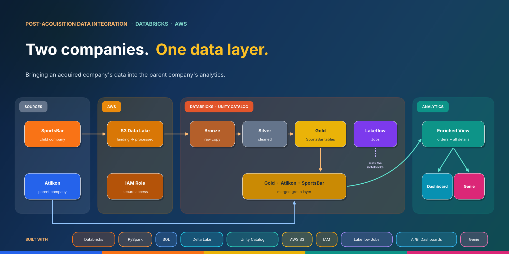
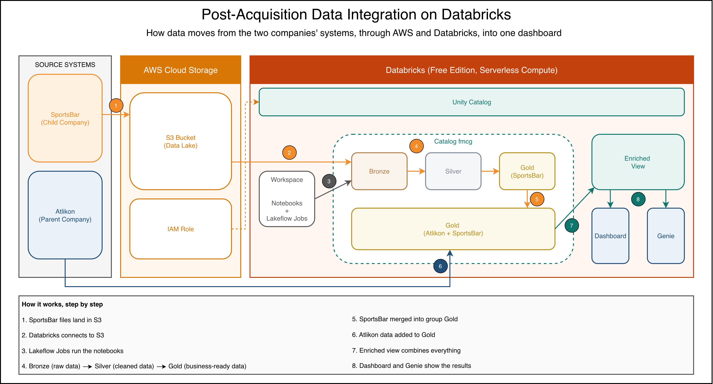
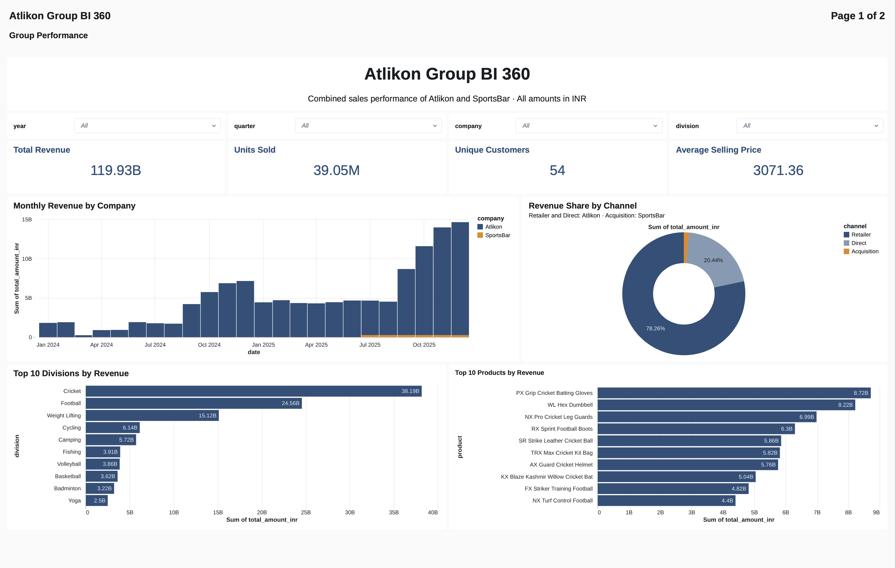
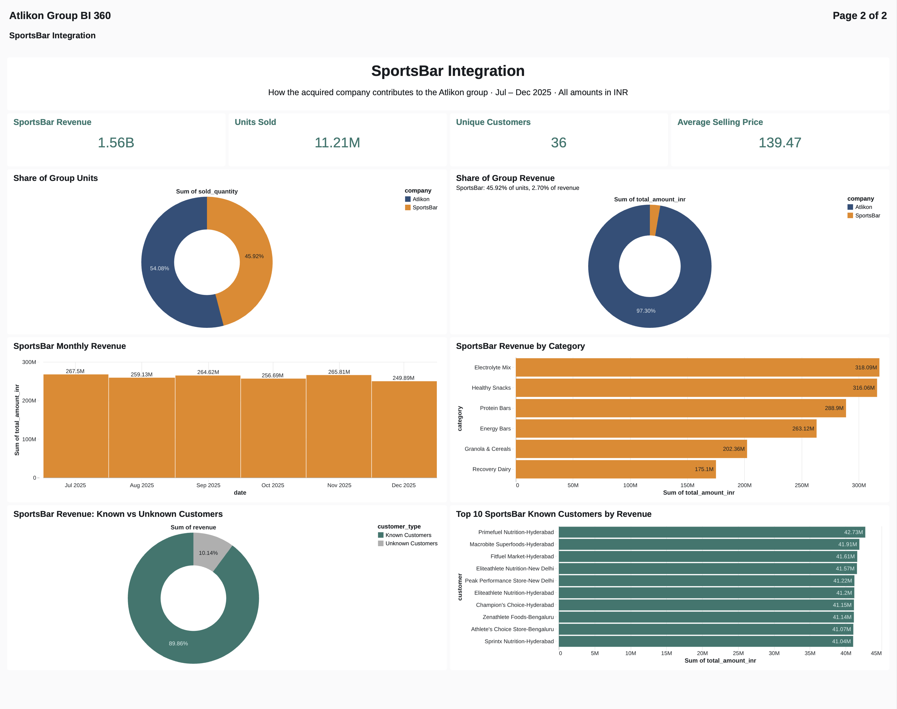

# Post-Acquisition Data Integration on Databricks

*An end-to-end Databricks pipeline that brings an acquired start-up's data into the parent company's analytics.*


---

## 1. Project Overview

Atlikon, a sports equipment manufacturer, acquired SportsBar, a fast-growing nutrition start-up whose data lived in spreadsheets and order-system exports with no data pipeline. This project builds that missing pipeline on Databricks: SportsBar's raw files land in AWS S3, are cleaned through bronze, silver and gold layers, and are merged into Atlikon's existing gold layer, so both companies can be reported on together in a single dashboard.

**Highlights**

- **End-to-end pipeline:** S3 data lake → bronze → silver → gold, with a historical backfill (Jul–Nov 2025) and incremental daily loads (Dec 2025)
- **Two companies, one data model:** SportsBar's data reshaped to fit Atlikon's, from product codes and divisions to yearly prices and monthly order totals
- **Reliable by design:** checks at every step, and re-running the pipeline with no new files produces identical results
- **Orchestrated with Lakeflow Jobs:** one job runs the notebooks in order: customers → products → pricing → orders
- **One dashboard for both companies:** *Atlikon Group BI 360*, plus Genie for questions in plain English
- **Key insight:** from July to December 2025, SportsBar sold **45.92% of the group's units** but brought in only **2.70% of its revenue**

able and long-term:** a pipeline that keeps processing new data as it arrives, not a one-off fix

---

## 2. Business Problem

Atlikon runs on mature, ERP-driven systems with an established bronze/silver/gold data pipeline. SportsBar, the start-up it acquired, had no data pipeline: its reports were Excel dashboards pulled straight from its order database. Leadership chose to keep SportsBar's teams and processes and to avoid a multi-year migration, but still needed answers across both companies, such as *"What is the group's total revenue?"* or *"What are the top products?"*

The two companies' data did not fit together:

| | Atlikon (parent) | SportsBar (acquired) |
|---|---|---|
| Data setup | Established bronze/silver/gold pipeline | Order system + Excel dashboards |
| Product IDs | Alphanumeric codes | Numeric IDs |
| Product hierarchy | Division → category → product → variant | Category → product |
| Customer details | Name, market, platform, channel | Name and city only |
| Prices | One price per product per year | One price per product per month |
| Order detail level | Monthly totals | Daily order lines |
| Data quality | Clean | Duplicates, typos, mixed date formats, invalid IDs, missing days |

---

## 3. Project Objectives

1. **One dashboard, reliable numbers:** aggregated analytics for both companies in a single dashboard, built on data that can be trusted
2. **A gentle learning curve:** a solution the team can understand and maintain without deep specialist knowledge
3. **Scalable and long-term:** a pipeline that keeps processing new data as it arrives, not a one-off fix

---

## 4. Dataset Information & Credit

The dataset was provided as part of the course **Data Engineering Project using Databricks Free Edition** by **Codebasics**. Full credit goes to **Mr. Dhaval Patel** and the Codebasics team for the dataset and learning resources.

The dataset contains sales data for both companies, split into a **full load** (historical data) and an **incremental load** (December 2025). All amounts are in INR.

**Atlikon (parent): CSV tables, already clean**

| Table | Contents |
|---|---|
| `dim_customers` | Customer code, name, market, platform, channel |
| `dim_products` | Product code, division, category, product, variant |
| `dim_gross_price` | Price per product per year |
| `fact_orders` | Monthly units sold per product and customer (Jan 2024 – Nov 2025) |
| `fact_orders` (incremental) | December 2025 |

**SportsBar (acquired): raw CSV files, with data quality issues**

| Folder | Contents |
|---|---|
| `customers` | Customer ID, name, city |
| `products` | Product ID, name, category |
| `gross_price` | Price per product per month |
| `orders` | Daily order files (Jul – Nov 2025) |
| `orders` (incremental) | Daily order files (December 2025) |

> **Note:** The dataset is not included in this repository, as the course provider does not permit it to be shared. This project was created for educational and portfolio purposes.

---

## 5. Project Architecture



The pipeline is split across three areas:

- **Source systems:** SportsBar's order system exports CSV files; Atlikon's data already arrives in Gold through its own pipeline.
- **AWS:** an **S3 bucket** acts as SportsBar's data lake, and an **IAM role** gives Databricks permission to read and move files in it.
- **Databricks:** **Unity Catalog** controls access and organises the data. **Lakeflow Jobs** runs the notebooks, which move SportsBar's data through **bronze → silver → gold** and merge it into the shared Gold layer. An **enriched view** combines everything for the **dashboard** and **Genie**.

---

## 6. Project Workflow

| # | Stage | Notebook(s) | What happens |
|---|---|---|---|
| 1 | **Setup** | `setup_catalog_schemas`, `utilities`, `create_dim_date` | Creates the `fmcg` catalog with bronze, silver and gold schemas, shared settings for all notebooks, and a monthly calendar table |
| 2 | **Parent data** | `load_parent_data` | Atlikon's tables are loaded straight into Gold, as its own pipeline already exists |
| 3 | **Connect to S3** | – | SportsBar's files are stored in S3; Databricks reaches them through an IAM role, a storage credential and an external location |
| 4 | **Dimensions** | `customers_`, `products_`, `pricing_data_processing` | Each table moves through bronze → silver → gold, then is merged into Atlikon's table |
| 5 | **Orders: full load** | `full_load_processing` | July–November orders are loaded, cleaned, summed per month and merged into Atlikon's `fact_orders` |
| 6 | **Orders: incremental load** | `incremental_load_processing` | New daily files are processed through staging tables, and each affected month is recalculated |
| 7 | **Parent December data** | `load_parent_incremental` | Atlikon's December file is added from a Unity Catalog volume with `COPY INTO` |
| 8 | **Orchestration** | Lakeflow Jobs | One job runs the SportsBar notebooks in order: customers → products → pricing → orders |
| 9 | **Reporting** | `create_enriched_view` | A view joins orders with all details and calculates revenue; the dashboard and Genie read from it |
| 10 | **Checks** | `pipeline_checks` | Row counts and totals confirm each run's results |

**How the layers work**

- **Bronze:** a raw copy of each file, plus the load time and source file name for traceability
- **Silver:** cleaned data: duplicates removed, typos and dates fixed, invalid IDs handled
- **Gold:** business-ready tables, merged into the shared Gold layer for both companies

**Full load vs incremental load**

- **Full load:** processes all historical files at once (the July–November backfill)
- **Incremental load:** new files arrive in `orders/landing/`, are processed, then moved to `orders/processed/`, so each file is loaded exactly once. Only the new batch is cleaned, and the affected month is recalculated from all its days, so partial months are completed rather than duplicated.

---

## 7. Data Quality & Key Decisions

### 7.1. Data quality findings (SportsBar)

| Issue found | How it was handled |
|---|---|
| ~5% of order rows had no quantity | Removed, since a sale can't be counted without a quantity |
| ~7% of order rows were exact duplicates | Removed |
| ~10% of orders had **placeholder customer IDs** instead of real ones | Kept and grouped under an **"Unknown Customer"** record, so the sales still count |
| Orders and prices for product IDs that don't exist in the product list | Excluded, and the unknown IDs flagged for business confirmation |
| Two days of order data missing (both month-end dates) | Not filled in |
| Customer names and categories with typos, extra spaces and mixed capitals | Standardised |
| Dates in five different formats | Standardised; every date readable |
| Prices that were negative or not numbers | Negative prices made positive; non-numeric prices set to 0 and skipped when picking the yearly price |

**Rule followed throughout:** remove a row only if it can't be counted correctly; keep it if just one descriptive detail is missing.

<details>
<summary><b>Full load in numbers</b></summary>

| Stage | Rows |
|---|---|
| Raw order rows (151 files) | 51,810 |
| − missing quantity | 2,607 |
| − duplicates | 3,616 |
| − orders for unknown products | 4,776 |
| **Clean daily orders** | **40,811** |
| **Monthly rows merged into `fact_orders`** | **3,060** |

</details>

### 7.2. Key decisions

- **SportsBar customers shown as "Name-City."** In SportsBar's data, one company can have a separate customer code for each city branch (15 company names appear in 2–3 cities). Adding the city keeps these branches apart in the dashboard. Atlikon's customer names are unique, with one code per company, so they stay as plain names.
- **"Unknown Customer" instead of deleting orders.** Orders with placeholder IDs are real sales, so they're kept under one clearly labelled record (~10% of SportsBar's revenue).
- **New product codes for SportsBar.** Its numeric IDs were turned into text codes in Atlikon's style, generated from the product name. The original IDs are kept, so orders can still be linked.
- **Missing divisions derived from categories,** so SportsBar's products fit Atlikon's product hierarchy.
- **Monthly prices → one yearly price** (the latest non-zero price), matching Atlikon's one-price-per-year model.
- **Daily orders → monthly totals,** matching the detail level of Atlikon's `fact_orders`.
- **Atlikon's data left untouched.** SportsBar's data was reshaped to fit the parent's model, and a check before each merge confirmed no Atlikon record could be overwritten.

---

## 8. Results

The final dashboard, **Atlikon Group BI 360**, has two pages, built on the enriched view.

### 8.1. Page 1: Group Performance (Jan 2024 – Dec 2025)



- **Strong growth:** Atlikon's revenue rose from INR 35.07B (2024) to INR 83.30B (2025), **+138%**.
- **Seasonal peak in Q4:** the strongest quarter in both years, bringing 56% of 2024's revenue and 47% of 2025's.
- **Revenue is concentrated:** Cricket (INR 38.19B) and Football (INR 24.56B) bring over half of all revenue. Cricket's entire revenue comes from just six products.
- **Sales channels:** Retailer 78.26%, Direct 20.44%, Acquisition (SportsBar) 1.30%.

### 8.2. Page 2: SportsBar Integration (Jul – Dec 2025)



- **High volume, low value:** SportsBar sold **45.92% of the group's units** but brought in only **2.70% of its revenue**, since its nutrition products sell for far less per unit than sports equipment.
- **Steady and balanced:** monthly revenue stays between INR 250M and INR 268M, and revenue is spread fairly evenly across six categories (11–20% each).
- **No dependence on a single buyer:** the top 10 known customers each bring INR 41–43M.
- **Unknown Customers:** orders with placeholder IDs account for INR 158.55M, **10.14%** of SportsBar's revenue.

> SportsBar's share is 1.30% on page 1 but 2.70% on page 2: page 1 covers Atlikon's full two years, while page 2 compares only the six months both companies share.

### 8.3. Genie

A Genie space on the same view answers questions in plain English, for example: *"Compare monthly revenue of Atlikon and SportsBar from July to December 2025."*

---

## 9. Validation

Every stage was checked with numbers, and a `pipeline_checks` notebook repeats the key checks after each run.

| Check | Result |
|---|---|
| Final row counts in Gold | `dim_customers` 54 (18 Atlikon + 35 SportsBar + 1 Unknown) · `dim_products` 415 · `dim_gross_price` 811 · `fact_orders` 101,212 |
| No Atlikon record overwritten | Checked before every merge: no matching codes between the two companies |
| Pipeline safe to re-run | Running the job again with no new files: same row counts, same totals |
| No file loaded twice | Re-running `COPY INTO` loaded 0 rows; the orders notebook stops cleanly when `landing/` is empty |
| Enriched view complete | Same row count as `fact_orders` (101,212), with no missing date, customer, product or price |
| Data coverage | Atlikon: Jan 2024 – Dec 2025 (24 months) · SportsBar: Jul – Dec 2025 (6 months), no months missing |

<details>
<summary><b>Incremental load test: December in two batches</b></summary>

| | Batch 1 (Dec 1–15) | Batch 2 (Dec 16–31) |
|---|---|---|
| Files | 15 | 16 |
| Clean rows | 3,960 | 3,874 |
| Monthly rows recalculated | 612 | 612 |
| Rows added to `fact_orders` | 612 | **0** |
| SportsBar's December units in `fact_orders` (running total) | 921,949 | **1,827,212** |

The second batch added no new rows but completed December's totals: the month was recalculated and updated, not duplicated.

</details>

---

## 10. Recommendations

### 10.1. For data quality (SportsBar)

1. **Fix placeholder IDs at the source.** About 10% of orders carry dummy customer IDs, and some orders and prices point to product IDs that don't exist. Requiring valid IDs when orders are entered would stop this from reaching reports at all.
2. **Confirm the unknown product ID.** One unknown product ID has thousands of orders and a full price history, which likely belongs to a product listed with an invalid ID. Once the business confirms it, its sales can be restored.
3. **Standardise exports.** One date format and one ID format in SportsBar's files would remove most of the cleaning work.
4. **Check for missing files.** Two days of orders were missing. A simple alert when a daily file doesn't arrive would catch this early.

### 10.2. For the business

5. **Plan for the Q4 peak.** Atlikon brings in around half of its yearly revenue in Q4, so stock and supply planning should be prepared well ahead of it.
6. **Watch the concentration in cricket and football.** Two divisions bring over half of the group's revenue, and cricket relies on just six products. A dip in either would hit the group hard.
7. **Use SportsBar's steady demand.** Its monthly revenue barely changes, which balances Atlikon's seasonal swings. Its strength is volume, so growth would come from higher-value products or bundles rather than more units.

---

## 11. Assumptions & Limitations

### 11.1. Assumptions

- **Atlikon's data is correct as delivered.** Its own pipeline already exists, so its tables were loaded into Gold without cleaning.
- **Four missing customer cities** were filled in with values confirmed by the business.
- **Yearly price = latest non-zero monthly price** for each SportsBar product, to match Atlikon's one-price-per-year model.
- **All amounts are in INR**, and all customers are businesses (B2B), not individual consumers.

### 11.2. Limitations

- **Revenue uses yearly prices.** Both companies' revenue is calculated as units × the yearly price, so price changes within a year aren't reflected. For SportsBar, whose prices rose during 2025, this slightly overstates revenue in the earlier months.
- **Some SportsBar data couldn't be used.** Orders and prices for unknown product IDs were excluded, and two missing days weren't filled in, so SportsBar's totals cover only the data that could be matched.
- **Unknown Customers can't be traced.** About 10% of SportsBar's revenue can't be attributed to a specific customer.
- **No year-over-year view for SportsBar,** since its data starts in July 2025.
- **Product codes depend on product names.** If a SportsBar product is renamed, it would receive a new code.
- **Tested on a small dataset in Databricks Free Edition.** The pipeline is designed to process new data incrementally, but it hasn't been tested at large scale.
- **Atlikon's own pipeline isn't part of this project.** Its December file was added manually from a volume.

---

## 12. Tech Stack & Skills

### 12.1. Tech stack

| Area | Tools |
|---|---|
| Platform | Databricks Free Edition (serverless compute) |
| Languages | Python (PySpark), SQL |
| Storage & governance | Delta Lake, Unity Catalog (catalog, schemas, volumes, storage credential, external location) |
| Cloud | AWS S3 (data lake), AWS IAM (access control) |
| Orchestration | Lakeflow Jobs |
| Reporting | AI/BI Dashboards, Genie |
| Diagram | draw.io |

### 12.2. Skills demonstrated

- **Data integration:** combining two companies with different IDs, hierarchies, price models and levels of detail into one data model
- **Data cleaning:** duplicates, typos, mixed date formats, invalid IDs and missing values, with every removal counted and explained
- **Data modelling:** fact and dimension tables, a calendar table, and a denormalised view for reporting
- **Pipeline design:** medallion architecture (bronze, silver, gold), full and incremental loads, staging tables, and upserts with `MERGE`
- **Data validation:** row counts, totals and match checks at every stage, and proof that re-runs are safe
- **Cloud setup:** connecting Databricks to S3 securely, with no access keys in the code
- **Analysis & reporting:** turning the data into a dashboard and finding insights such as growth, seasonality, revenue concentration and the volume-vs-value gap
- **Documentation:** markdown notes in every notebook and a clear project write-up

---

## 13. Project Structure

## Project Structure

```
post-acquisition-data-integration/
├── README.md
├── .gitignore
├── assets/
│   └── project_banner.png
├── architecture/
│   ├── project_architecture.drawio
│   └── project_architecture.png
├── dashboards/
│   ├── atlikon_group_bi_360_group_performance.pdf
│   ├── atlikon_group_bi_360_group_performance.png
│   ├── atlikon_group_bi_360_sportsbar_integration.pdf
│   └── atlikon_group_bi_360_sportsbar_integration.png
└── notebooks/
    ├── 01_setup/
    │   ├── setup_catalog_schemas.ipynb        catalog and bronze/silver/gold schemas
    │   ├── utilities.ipynb                    shared settings used by every notebook
    │   ├── load_parent_data.ipynb             checks Atlikon's tables in Gold
    │   ├── create_dim_date.ipynb              monthly calendar table
    │   └── load_parent_incremental.ipynb      Atlikon's December data
    ├── 02_sportsbar_pipeline/
    │   ├── dimension_data_processing/
    │   │   ├── customers_data_processing.ipynb
    │   │   ├── products_data_processing.ipynb
    │   │   └── pricing_data_processing.ipynb
    │   └── fact_data_processing/
    │       ├── full_load_processing.ipynb         Jul–Nov 2025 backfill
    │       └── incremental_load_processing.ipynb  daily updates (Dec 2025)
    ├── 03_reporting/
    │   └── create_enriched_view.ipynb         view for the dashboard and Genie
    └── pipeline_checks.ipynb                  checks after each run
```
---

## 14. How to Run

> The dataset isn't included (see [Dataset Information & Credit](#4-dataset-information--credit)), so these steps describe how the project is set up with the course data.

### 14.1. Prerequisites
- A **Databricks** account (Free Edition works)
- An **AWS** account with access to S3 and IAM

### 14.2. Steps

1. **Import the notebooks** into your Databricks workspace, keeping the folder structure.
2. **Create an S3 bucket** and upload SportsBar's files in this layout:
   ```
   <bucket>/
   ├── customers/
   ├── products/
   ├── gross_price/
   └── orders/
       └── landing/      daily order files
   ```
3. **Connect Databricks to S3:** create an IAM role with access to the bucket, then a **storage credential** and an **external location** in Unity Catalog.
4. **Update the bucket path** in `01_setup/utilities` (`s3_base_path`).
5. **Run the setup:** `setup_catalog_schemas`, then upload Atlikon's four CSV tables into `fmcg.gold`, and run `load_parent_data` and `create_dim_date`.
6. **Run the SportsBar pipeline:** the three dimension notebooks (customers → products → pricing), then `full_load_processing`.
7. **Load new data:** place new daily order files in `orders/landing/` and run `incremental_load_processing`. For Atlikon's December file, upload it to a Unity Catalog volume and run `load_parent_incremental`.
8. **Create the reporting view:** run `create_enriched_view`.
9. **Check the results:** run `pipeline_checks`.
10. **Optional:** create a Lakeflow Job to run step 6 automatically, and build the dashboard on `fmcg.gold.view_fact_orders_enriched`.

---

## 15. Future Improvements

- **More accurate SportsBar revenue:** use SportsBar's monthly prices for its own revenue, so price changes within the year are reflected.
- **Automatic runs:** trigger the job whenever a new file lands in `orders/landing/`, instead of running it manually.
- **Data quality alerts:** stop or flag a run automatically when checks fail, for example when a daily file is missing or too many IDs are invalid.
- **Stable product keys:** keep a fixed mapping of SportsBar's product IDs to codes, so renaming a product doesn't create a new code.
- **Track changes over time:** keep the history of customer and product changes (e.g. a customer moving city) instead of overwriting them.
- **Faster, more resilient job:** run independent tasks in parallel, so one failure doesn't stop the whole pipeline.
- **Sales forecasting:** use the combined monthly data to forecast demand, supporting the supply chain and inventory planning the merger was meant to enable.

---

## 16. Conclusion

This project shows that an acquired company's messy data can be brought into the parent's analytics without a long migration. Measured against the three objectives:

1. **One dashboard, reliable numbers:** both companies are now reported together in *Atlikon Group BI 360*, and every stage is backed by checks: no duplicates, no overwritten records, and identical results on re-runs.
2. **A gentle learning curve:** the pipeline uses familiar tools (Python, SQL and notebooks with short notes), shared settings in one place, and a clear bronze → silver → gold structure that's easy to follow.
3. **Scalable and long-term:** new files are processed incrementally and automatically through a scheduled job, so the same pipeline keeps working as SportsBar's data grows.

Beyond the pipeline, the combined data already answers questions neither company could before, such as SportsBar contributing almost half of the group's units but under 3% of its revenue.

